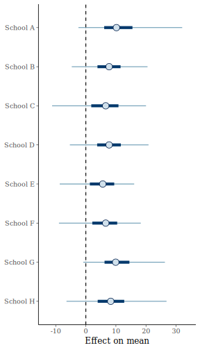
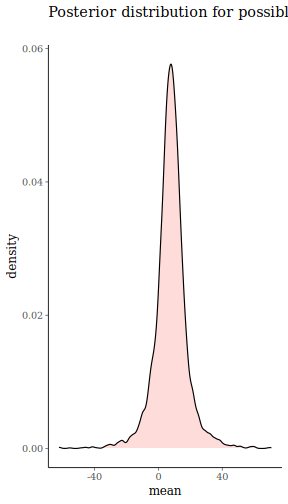
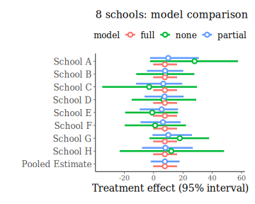
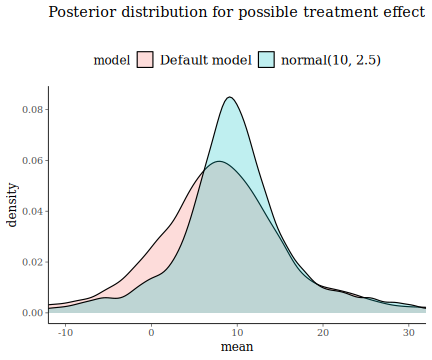
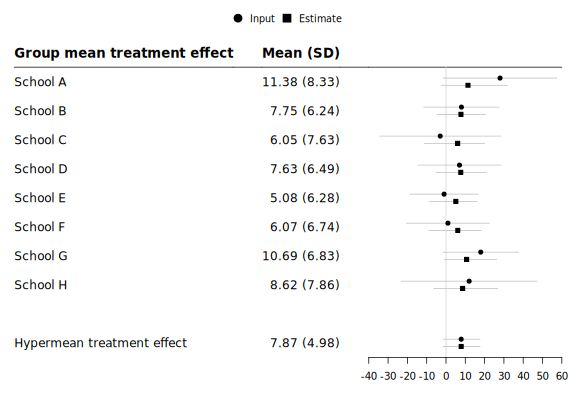
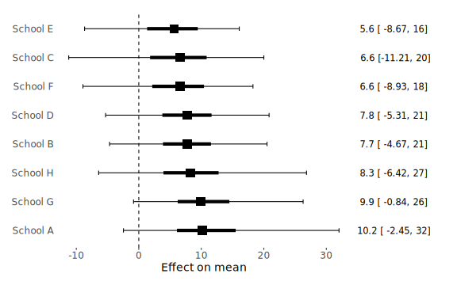
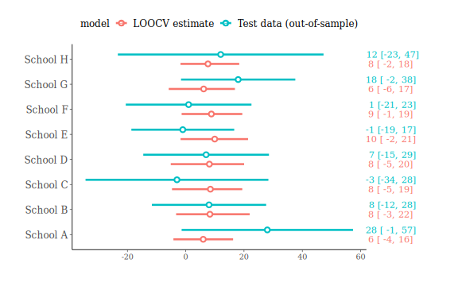

This vignette is written for _baggr_ users who want to learn about (Bayesian)
meta-analysis concepts and analyse data on typically continuous variables. If
you are looking for information that is more specific to binary data, please
read `vignette("baggr_binary")`. We continue to welcome feedback and
suggestions.

# What is baggr?

_baggr_ (pronounced "bagger" or "badger" and short for Bayesian Aggregator) is a
package for aggregating evidence on causal effects measured in several separate
and different instances. These instances may be different studies, groups,
locations or "sites" however conceptualised. We refer to these separate pieces
of evidence as "groups" for the remainder of this vignette When each group is a
study, the model is that of _meta-analysis_, but aggregation of evidence is not
limited to this case.

One of the most basic objects of interest is the average treatment effect (ATE),
the difference in the mean outcome in treatment and control groups; for more
information see work by @rubin_estimating_1974. In meta-analysis we are often
interested in the average of this average effect across groups, estimated using
all the evidence from all the groups. Consider the case where the evidence in
each study or group is generated by comparing the outcomes of treatment and
control samples in a randomized experiment. We will ignore any covariate
information at the individual or group level for now.

Consider some outcome of interest $y_{ik}$ such as consumption, income or health
outcomes for a household or individual $i = 1,2,...N_k$ in study group $k =
1,2....K$. Let $Y_k$ denote the $N_k$-length vector of observed outcomes from
group $k$. Denote treatment status by $T_{ik}$, and denote by $T_k$ the
$N_k$-length vector of all treatment status indicators from group $k$. In
individual-level models, treatment can be either binary or a multi-level factor
(for example, multiple treatment arms plus control).

Suppose that $y_{ik}$ varies randomly around its mean $\theta_{0k} + \theta_k
T_i$. In this setting $\theta_k$ is the treatment effect in group $k$. The
random variation in $y_{ik}$ may be the result of sampling variation or
measurement error, as in the @rubin_estimation_1981 model, or it may be the
result of unmodelled heterogeneity or uncertainty in outcomes for individuals
within the group. Allow the variance of the outcome variable $y_{ik}$ to vary
across sites, so $\sigma_{y_k}^2$ may differ across $k$.


Summary-data inputs use `yi` and `sei` for effect estimates and their standard
errors, with `y0i` and `se0i` added for baseline/control means in `vivs`.

::: {.note style="border: 1px solid #ccc; padding: 0.75em 1em; margin: 1em 0;"}
In baggr 0.9 default column names have changed to follow a convention popular
in meta-analysis packages. The old version used `tau` for treatment effects
and `mu` for control means. The new version prefers column names `yi` and
`y0i` for their point estimates, with `sei` and `se0i` for standard errors.
The corresponding parameters are $\theta_k$ and $\theta_{0k}$.
You can still use the old notation.
:::

Other column names can be mapped explicitly with strings, for example
`baggr(df, yi = "effect", sei = "effect_se", model = "rubin")`.
Exact aliases `y`/`se` and `y0`/`se0`/`y`/`se` are recognised. Legacy inputs
produce an informational message unless mappings are explicit or `silent =
TRUE`.
A `slab` column, or `slab = "study_label"`, can supply study labels for
summary data; an explicit `group` argument takes precedence.

## Recent features

This vignette has been updated in 2026 for _baggr_ v0.8. Since 2020, _baggr_ has
added several user-facing features that are useful in standard applied
workflows:

* Selection models for Rubin summary-data models: see `selection()`
* Funnel-plot diagnostics via `funnel_plot()`. Also new plotting via `bubble()`.
* Multi-arm treatment handling in individual-level data workflows via `baggr()`.
* Cluster-level random effects support through the `cluster` argument in
  `baggr()`.
* Model comparison and visualization with `baggr_compare()`, `loocv()`, and
  associated plotting methods.


## Data inputs: reported effects or full individual-level data sets

For average effects aggregation, _baggr_ detects the input format automatically.
The table below summarises the user-facing formats and the corresponding
internal category returned by `detect_input_type()`.

| Input format | Required columns (minimum) | Internal input type | Typical default model |
|---|---|---|---|
| Effect estimates only (continuous outcomes) | `yi`, `sei` | `pool_noctrl_narrow` | `rubin` |
| Control mean + treatment effect summary (continuous outcomes) | `y0i`, `se0i`, `yi`, `sei` | `pool_wide` | `vivs` |
| Binary summary counts (2x2-style per group) | `a`, `b`, `c`, `d` (plus optional `group`) | `pool_binary` | `rubin` (or `logit` if requested) |
| Individual-level data (continuous outcomes) | `group`, `treatment`, `outcome` | `individual` | `rubin_full` |
| Individual-level data (binary outcomes) | `group`, `treatment`, `outcome` with binary `outcome` | `individual_binary` | `logit` |

If you supply `cluster = ...`, _baggr_ will fit cluster random intercepts in
models that support clustering for individual-level data.

Examples:


``` r
# Auto-detect binary summary input (a, b, c, d columns)
baggr(df_binary_summary)

# Auto-detect individual-level input with a multi-arm treatment factor
baggr(df_multiarm_individual,
      outcome = "outcome",
      treatment = "treatment_arm",
      group = "study")
```

As an example of an individual-level data set we include in data frames
`microcredit` and `microcredit_simplified`. The former contains all the
microcredit outcome data used in @meager_aggregating_2019-1, standardized to USD
PPP in 2009 terms per two weeks (a time period is necessary as these are flow
variables). It therefore contains NAs and other undesirable features, to allow
the user to see how _baggr_ handles these common data issues. The data set
`microcredit_simplified` has these issues cleaned up and contains only one
outcome of interest, consumer durables spending.

_baggr_ also has a function  that automatically produces summary data from full
data sets, in case one wishes to run the comparatively faster summary-data
models. The `prepare_ma()` function applied to a dataframe with columns named
`"group"`, `"outcome"`, and `"treatment"` automatically estimates the control
group means, treatment effects, and associated standard errors for each group
using an Ordinary Least Squares regression. The resulting output is already
formatted as a valid input to the `baggr()` command itself:


``` r
prepare_ma(microcredit_simplified, outcome = "consumption")
#>   group      y0i        yi      se0i       sei  n0i   ni
#> 1     1 303.6065  5.510755  2.559897  4.101140 8298 8262
#> 2     2 280.0887 50.449393 11.141075 22.156317  260  701
#> 3     3 196.4215 -5.171338 14.432604 19.266339  444  551
#> 4     4 276.2791  4.641604  3.730907  5.451094 3248 3579
#> 5     5 327.5246 -2.935731  4.027768  6.022955 2771 2716
```


## ATE aggregation models in _baggr_

_baggr_ includes summary-data models and individual-level-data models for
aggregating average treatment effects.

### Normal-normal hierarchical (Rubin) model

This default model is often referred to in the literature as the
normal-normal hierarchical model. You can specify it as `model = "rubin"`
or `model = "nnhm"`.

Consider first the evidence aggregation model from @rubin_estimation_1981,
discussed extensively in Chapter 5 of @gelman_bayesian_2013; the model consists
of a hierarchical likelihood as follows:

\begin{equation}
\begin{aligned}
\hat{\theta}_k &\sim N(\theta_k, \hat{se_k}^2) \; \forall \; k \\
\theta_k &\sim N(\theta, \sigma_{\theta}^2) \; \forall \; k .
\end{aligned}
\label{rubin model}
\end{equation}

The motivation for this model structure is discussed in detail in the sources
above and in @meager_aggregating_2019-1. To complete the Bayesian model, we now
need priors. _baggr_ has a set of default priors for each model (adjusted to
data), as well as allowing the user to specify her own priors if desired. In the
Rubin model, the defaults are:

* For $\theta$, `prior_hypermean = normal(0, 10*max(abs(yi)))`.
* For $\sigma_{\theta}$, `prior_hypersd = uniform(0, 10*sd(yi))` (for at least
  two groups).

### Varying-intercept, varying-slope model

In case you also have data on the control groups' mean outcomes and the
uncertainty on those, you can augment the @rubin_estimation_1981 model to
incorporate that information. Following @meager_aggregating_2019-1, if one has
access to the estimated control means  $\{\hat{\theta}_{0k}\}^K_{k=1}$ and their
standard errors $\{\hat{se}_{\theta_0 k}\}^K_{k=1}$, one can fit a joint
Gaussian model on the pairs $\{\hat{\theta}_{0k},\hat{\theta}_k\}_{k=1}^{K}$:

\begin{equation}
\begin{aligned}
\hat{\theta}_k &\sim N(\theta_k, \hat{se_{\theta k}}^2) \; \forall \; k \\
\hat{\theta}_{0k} &\sim N(\theta_{0k}, \hat{se_{\theta_0 k}}^2) \; \forall \; k \\
\left( \begin{array}{c}
\theta_{0k}\\
\theta_{k}
\end{array} \right)
&\sim
N\left( \left(
\begin{array}{c}
\theta_0\\
\theta
\end{array} \right), V \right) \; \text{where} \;V = \left[ \begin{array}{cc} \sigma^2_{\theta_0} & \sigma_{\theta\theta_0} \\ \sigma_{\theta\theta_0} & \sigma_{\theta}^2 \end{array} \right]\forall \; k. \\
\end{aligned}
\label{full data model}
\end{equation}

In _baggr_ this is the varying-intercept, varying-slope model (`"vivs"`):
a joint model that allows random effects on both control means and treatment
effects. It is a bivariate hierarchical model that jointly estimates
study-specific control means and treatment effects, allowing them to be
correlated across studies. In previous baggr versions it was referred to as
the `"mutau"` model. You can still use that name when specifying the model;
`"bivariate"` is another alias. For individual-level data, use `"vivs_full"`
(aliases `"mutau_full"` and `"bivariate_full"`). Here $\theta_{0k}$
is the true control or baseline mean in group $k$, while $\theta_k$ is
the true treatment effect. Their population means are $\theta_0$ and
$\theta$. The observed estimates $\hat{\theta}_{0k}$ and
$\hat{\theta}_k$ are supplied as `y0i` and `yi`, with standard errors
`se0i` and `sei`, respectively.

If you have only few groups, the priors on $V$ will need to be relatively strong
to avoid overfitting. See @meager_aggregating_2019-1 for more discussion of this
issue in particular, or see the [Stan Manual on hierarchical
priors](https://mc-stan.org/docs/2_18/stan-users-guide/multivariate-hierarchical-priors-section.html).
In this model, defaults are:

* `prior_hypermean = multinormal(c(0, 0), diag(c(100*max(abs(y0i)),
  100*max(abs(yi)))))`.
* `prior_hypersd = uniform(0, 10*sd(yi))`.
* `prior_hypercor = lkj(3)`.

### Individual-level models

For individual-level data (`outcome`, `treatment`, `group`), _baggr_ supports
three likelihood models:

* `"rubin_full"`: $y_i \sim N(\theta_{0,k[i]} + \theta_{k[i]} z_i +
  x_i^\top\beta + u_i, \sigma_{y,k[i]}^2)$.
* `"vivs_full"`: $y_i \sim N(\theta_{0,k[i]} + \theta_{k[i]} z_i +
  x_i^\top\beta, \sigma_{y,k[i]}^2)$.
* `"logit"`: $y_i \sim \text{Bernoulli}(\text{logit}^{-1}(\theta_{0,k[i]} +
  \theta_{k[i]} z_i + x_i^\top\beta))$.

## Models, their inputs, hierarchy and priors: a summary table

<!-- This is a mess to edit, sorry. But it presents nicely in Markdown -->

| Model (name in `baggr`) | Required input columns | Hierarchical structure | Prior knobs (main arguments) |
|---|---|---|---|
| Normal-normal hierarchical (Rubin) summary-data model (`"rubin"`) | `yi`, `sei` (optional `group`, optional `covariates`) | With `pooling = "partial"`: $\theta_k \sim N(\theta, \sigma_\theta^2)$. `pooling = "none"` uses independent study effects; `pooling = "full"` uses one common effect. | `prior_hypermean` (for $\theta$), `prior_hypersd` (for $\sigma_\theta$), `prior_beta` (if `covariates` used), `prior_selection` (if `selection` is used). |
| Varying-intercept, varying-slope summary-data model (`"vivs"`) | `y0i`, `se0i`, `yi`, `sei` (optional `group`, optional `covariates`) | With `pooling = "partial"`: $\begin{pmatrix}\theta_{0k}\\\theta_k\end{pmatrix} \sim N\left(\begin{pmatrix}\theta_0\\\theta\end{pmatrix}, V\right)$, where $V$ is parameterized via scales and a correlation matrix. `pooling = "none"` and `"full"` follow the same none/full pooling interpretation as above. | `prior_hypermean` (for $(\theta_0,\theta)$), `prior_hypersd` (scales in $V$), `prior_hypercor` (correlation in $V$), `prior_beta` (if `covariates` used). |
| Rubin individual-level model (`"rubin_full"`) | `outcome`, `treatment`, `group` (optional individual-level `covariates`, optional `cluster`) | Treatment effects follow Rubin-style pooling across groups (`none`/`partial`/`full`), with optional baseline pooling via `pooling_control`. | `prior_hypermean` (treatment hypermean), `prior_hypersd` (treatment heterogeneity), `prior_control` and `prior_control_sd` (control arm baseline and its heterogeneity), `prior_sigma` (within-group outcome SD), `prior_beta`, `prior_cluster`. |
| Varying-intercept, varying-slope individual-level model (`"vivs_full"`) | `outcome`, `treatment`, `group` (optional individual-level `covariates`) | Partial-pooling form jointly pools $(\theta_{0k}, \theta_k)$ with a multivariate normal hierarchy and correlation; none/full pooling use the corresponding independent/common parameter special cases. | `prior_hypermean`, `prior_hypersd`, `prior_hypercor`, `prior_control_sd` (for baseline SD under partial baseline pooling), `prior_sigma`, `prior_beta`. |
| Logistic individual-level model (`"logit"`) | `outcome` (0/1), `treatment`, `group` (optional individual-level `covariates`) | Log-odds treatment effects are pooled across groups (`none`/`partial`/`full`); control-arm log-odds can be pooled separately via `pooling_control`. | `prior_hypermean`, `prior_hypersd`, `prior_control`, `prior_control_sd`, `prior_beta`. |

<!-- | Quantiles (`"quantiles"`)         | `outcome`, `treatment`, `group`  | See Meager (2019)    | See Meager (2019)          | See Meager (2019)  | -->

Where inputs are individual-level data, i.e.  `outcome`, `treatment`, `group`,
you can specify column names in as arguments to `baggr()` function.

## Prior choice in baggr

In the "Rubin" and varying-intercept, varying-slope models, the user can specify
custom priors beyond the defaults using the prior arguments. These prior
arguments are subdivided into 3 categories:

* Priors for the hypermean, the average effect across groups, such as  $\theta$
  or the vector $(\theta_0, \theta)$. This is denoted using the
  `prior_hypermean` argument in baggr.

* Priors for the hyper-standard-deviations $\sigma_{\theta}$, the standard
  deviation of effects across groups. This also refers to the prior on the
  scales of the hyper-variance-covariance matrix $V$ in the varying-intercept,
  varying-slope model. This type of parameter is denoted `prior_hypersd` in
  baggr.

* Priors on hypercorrelations between parameters that may co-vary across the
  groups. When working with multi-dimensional parameters at the upper level of
  the model (aka performing multivariate shrinkage), this is the correlation in
  the distribution of the different parameters across the groups. For example,
  in the varying-intercept, varying-slope model this parameter is the
  correlation matrix $\Omega$ that governs the hyper-variance-covariance matrix
  $V$. This type of parameter is denoted `prior_hypercor` in baggr.

The possible prior distributions we allow for in the current version are:

* For `prior_hypermean` we allow `"normal"`, `"uniform"`, `"cauchy"`,
  `"lognormal"`, and (generalised) `"student_t"` with any parameter values which
  are logically possible given support constraints (e.g. user cannot specify a
  negative variance on a normal distribution or a negative scale on a Cauchy)
  When the model has a vector hypermean, as in the varying-intercept,
  varying-slope model, baggr applies the given prior to all the elements of the
  vector independently. If the user wishes to specify a prior dependence between
  the components, one can supply prior_hypermean with a multinormal argument
  (see `?priors` for details).
* For `prior_hypersd` we allow `"normal"` and `"uniform"` with any parameter
  values which are logically possible given support constraints (as above).
* For `prior_hypercor`, which is only necessary when there is a multivariate
  shrinkage operation (as in the varying-intercept, varying-slope model) we
  allow an LKJ correlation prior (`"lkj"`) with any parameter values which are
  logically possible given support constraints. For further details of this
  strategy see Meager (2019).


Notation for priors is "plain-text", in that you can write the distributions as
`normal()`, `uniform()` etc. See `?priors` for details, or continue to the
example below with the Rubin model.

## Running the normal-normal hierarchical (Rubin) model in _baggr_

To demonstrate the Rubin model in _baggr_, consider the 8 schools example from
Rubin (1981). In this dataset, 8 schools in the United States performed similar
randomized experiments to estimate the causal effect of an SAT tutoring program
on learning outcomes. Reported  treatment effects and their standard errors are
included in  _baggr_ as a data frame:


``` r
schools
#>      group yi sei
#> 1 School A 28  15
#> 2 School B  8  10
#> 3 School C -3  16
#> 4 School D  7  11
#> 5 School E -1   9
#> 6 School F  1  11
#> 7 School G 18  10
#> 8 School H 12  18
```


To fit the model in _baggr_ (having followed the installation instructions and
loaded the package):


``` r
baggr_schools <- baggr(schools, model = "rubin", pooling = "partial")
```

This creates a `baggr` class object, and you can access the underlying `stanfit`
object by calling `baggr_schools$fit`. If you don't change the default priors,
then _baggr_ will print a message informing you of the priors it has chosen.

Printing `baggr_schools` returns a summary of the posterior inference.
First _baggr_ records the model type and the pooling regime chosen by the user
or implemented by default. Second, _baggr_ returns inference on the aggregate
treatment effect $\theta$ by reporting its posterior mean and 95\% uncertainty
interval, and similar inference on the hyper-SD $\sigma_{\theta}$.
Lastly, it prints the "updated" inference on each of the groups' treatment
effects, displaying their new posterior means, standard deviations and pooling
factors (see below).


``` r
print(baggr_schools)
#> Model type: Normal-normal hierarchical (Rubin) model with aggregate data 
#> Pooling of effects: partial 
#> 
#> Aggregate treatment effect (on mean), 8 groups:
#> Hypermean (theta) =  7.87 with 95% interval -1.51 to 17.67 
#> Hyper-SD (sigma) = 6.60 with 95% interval 0.30 to 21.00 
#> Posterior predictive effect = 7.89 with 95% interval -12.82 to 28.69 
#> Total pooling (1 - I^2) = 0.76 with 95% interval 0.24 to 1.00 
#> 
#> Group-specific treatment effects:
#>          mean median  sd   2.5% 97.5% pooling
#> School A 11.4   10.2 8.3  -2.45    32    0.82
#> School B  7.7    7.7 6.2  -4.67    21    0.72
#> School C  6.0    6.6 7.6 -11.21    20    0.84
#> School D  7.6    7.8 6.5  -5.31    21    0.75
#> School E  5.1    5.6 6.3  -8.67    16    0.69
#> School F  6.1    6.6 6.7  -8.93    18    0.75
#> School G 10.7    9.9 6.8  -0.84    26    0.72
#> School H  8.6    8.3 7.9  -6.42    27    0.86
```

<!-- This is quite similar to the output from the version of the model suggested in ["How to use rstan"](https://github.com/stan-dev/rstan/wiki/RStan-Getting-Started) tutorial, the small difference probably arising from the different default priors. -->

### Examining treatment and study effects

The overall treatment effect and heterogeneity parameters are available with
`treatment_effect()`, as components `theta` and `sigma`. If you only need the
mean effect or its hyper-SD, use the shorter `hypermean()` and `hypersd()`
functions.


``` r
hypermean(baggr_schools)
#>         mean   median       sd     lower    upper width
#> [1,] 7.86833 7.829399 4.976867 -1.506399 17.67341  0.95
#> attr(,"effect")
#> [1] "mean"
hypersd(baggr_schools)
#>          mean   median       sd     lower    upper width
#> [1,] 6.604327 5.292293 5.624765 0.3019347 21.00463  0.95
#> attr(,"effect")
#> [1] "mean"
```

Study-level posterior effects are available with `group_effects()`; the alias
`study_effects()` returns the same object.


``` r
head(group_effects(baggr_schools, summary = TRUE))
#>               mean    median       sd      lower    upper width
#> School A 11.383459 10.181572 8.334414  -2.454676 32.03343  0.95
#> School B  7.746749  7.742173 6.243889  -4.673032 20.51266  0.95
#> School C  6.045027  6.608648 7.626272 -11.209210 20.00639  0.95
#> School D  7.630902  7.750181 6.488706  -5.307645 20.84566  0.95
#> School E  5.084300  5.631699 6.279290  -8.671156 16.07566  0.95
#> School F  6.073942  6.610305 6.738627  -8.934797 18.26598  0.95
treatment_effect(baggr_schools, summary = TRUE)
#> $theta
#>         mean   median       sd     lower    upper width
#> [1,] 7.86833 7.829399 4.976867 -1.506399 17.67341  0.95
#> attr(,"effect")
#> [1] "mean"
#> 
#> $sigma
#>          mean   median       sd     lower    upper width
#> [1,] 6.604327 5.292293 5.624765 0.3019347 21.00463  0.95
#> attr(,"effect")
#> [1] "mean"
```

### Summary names and dimensions

Model summaries use numeric columns `mean`, `median`, `sd`, `lower`, `upper`,
and `width`, in that order. `width` records the requested central interval
probability, including when an estimate is unavailable. A single effect gives
a matrix with one row per quantity and its name in the `effect` attribute;
multiple effects give an array with named effects in the third dimension.
Aggregate summaries have one row, and predictions conditional on `newdata`
have one row per observation. Raw draws retain their existing layout.


``` r
group_summary <- group_effects(baggr_schools, summary = TRUE, prob = 0.8)
colnames(group_summary)
#> [1] "mean"   "median" "sd"     "lower"  "upper"  "width"
attr(group_summary, "effect")
#> [1] "mean"
```

For percentage labels, `group_effects(..., rename_int = TRUE)` and
`treatment_effect(..., rename_int = TRUE)` rename only the bounds and omit
`width`; the `median` column keeps its name.

### Choosing priors

It is possible to fit the Rubin model without specifying any priors, in which
case the user is notified about the automatic prior choice that _baggr_
performs. But the priors can also be easily customised by using `prior_`
arguments to `baggr()`. The Rubin model performs univariate shrinkage so we will
not need to specify a hyper-correlation prior, but we can specify some custom
priors on the hyper-mean and hyper-sd. If desired, the user can specify only
some priors as custom distributions - the rest will be chosen automatically and
the user will be notified of this in the output.

Consider changing both as an example, say placing a Normal prior with mean -5
and standard deviation 10 on our hypermean $\theta$, as well as placing a
uniform prior with lower bound 0 and upper bound 5 on our
hyper-standard-deviation $\sigma_{\theta}$. Thus, what is expressed
mathematically as $\theta \sim N(-5,10)$ and $\sigma_{\theta} \sim U[0,5]$ is
expressed in baggr as follows:


``` r
baggr(schools, "rubin",
      prior_hypermean = normal(-5, 10),
      prior_hypersd   = uniform(0, 5))
```

<!-- #[WORKING SECTION Suppose you have the full individual-level dataset for all groups (case 3 above) but still wish to run the Rubin model: _baggr_ can do this automatically, you do not need to manually estimate the group-specific effects and standard errors yourself. To see how it works, check out the microcredit dataset analysed in Meager (2019) which is stored in _baggr_ as the data frame "microcredit". Have a look at the tail of the data frame, which tells you that these households are from the "Tarozzi" et al study group (the Ethiopia trial), for which we have expenditures, revenue and profit data, as well as the treatment indicator. -->
<!-- # ```{r} -->
<!-- # tail(microcredit) -->
<!-- # ``` -->
<!-- # _baggr_ will only understand the 3 types of formatting described above, and while we have already stacked this dataset, we now need to choose a single outcome to focus on.  ] -->

It is also possible to pass your custom priors as a list to baggr, as follows:

``` r
custom_priors <- list( hypermean = cauchy(0,25), hypersd = normal(0,30))
baggr(schools, "rubin", pooling = "partial", prior = custom_priors)
```


Note that the Rubin model assumes Gaussian distribution of effects across
groups. This is generally appropriate as a first pass at the problem (see
@mcculloch_misspecifying_2011) _except_ if the distribution is known to be
asymmetric for scientific reasons. For example, if you are working with risk
ratios or odds ratios these statistics cannot be negative and the chosen
hyper-distribution should typically reflect that. However, in many cases it is
possible and indeed standard to maintain the Gaussian assumption on a transform
of the object: for example, you can safely fit the Rubin model to the logarithm
of the risk ratios or odds ratios. While bearing in mind that log transforms
obscure inherent dependencies between means and variances in the raw scale, this
is still much better than applying a Gaussian to the raw object itself.


## Understanding and criticising _baggr_ model performance

_Baggr_ models are run in Stan, and the fit and results need to be checked,
understood and criticised as you would any stan model or indeed any MCMC model
fitting exercise. **You must pay attention to printed warnings about the Rhat
criterion: if you see a warning that Rhat statistic exceeds 1.05 for any
parameter, you MUST NOT use the results for inference.** This warning means the
MCMC chains have not converged, and it is exceedingly unlikely that the
"posterior inference" printed out corresponds to anything close to the true
posterior implied by your model and data. **If you use results from which the
Rhat statistic exceeds 1.05 YOUR INFERENCE WILL BE WRONG.**

If you see this warning, try re-running the model with the option `iter` set to
a large number such as 10,000, as below. It is also good practice to run many
chains, such as 8 rather than the default 4, to have a greater chance to detect
pathological MCMC behaviour. You do this by passing _baggr_ the stan arguments
`iter = 10000` and `chains = 8`, like so:


``` r
baggr_schools <- baggr(schools, model = "rubin", pooling = "partial",
                       iter = 10000, chains = 8)
```

Other warnings you may see involve "divergent transitions". While not as serious
as high Rhat, this can signal problems with the model. As the stan message that
you will see suggests, try adjusting `adapt_delta` argument above 0.8, e.g. to
0.99; same as with `iter` and `chains`, since you can pass Stan arguments within
`baggr()`, you can simply do:


``` r
baggr_schools <- baggr(schools, model = "rubin", pooling = "partial",
                       iter = 10000, chains = 8,
                       control = list(adapt_delta = 0.99)) #see rstan documentation for details
```


## Measuring "pooling"

It is often useful to measure the extent to which the hierarchical model is
"pooling" or sharing information across the groups in the process of
aggregation. _Baggr_ automatically computes and prints such a metric, as seen
above. You can access more details by writing `pooling(baggr_schools)` or
`heterogeneity(baggr_schools)`.

### Estimate of pooling in each group

In the output above we can see a "pooling" column next to each group. This is a
statistic due to @gelman_bayesian_2006.

In a partial pooling model (see [baggr]), group $k$ (e.g. study) has a treatment
effect
estimate, with some SE around the real $\theta_k$, i.e.
$\hat{\theta}_k \sim \mathcal{N}(\theta_k, \hat{se_k})$
(\hat{se_k} itself is an estimate of the true $se_k$).
Each $\theta_k$ itself is distributed with mean $\theta$ and variance
$\sigma_{\theta}^2$.

The quantity of interest is ratio of variability in $\theta$ to total
variability.
By convention, we subtract it from 1, to obtain a _pooling metric_ $p$.

$$p = 1 - \frac{\sigma_{\theta}^2}{\sigma_{\theta}^2 + se_k^2}$$

* If $p < 0.5$, that means the variation across studies is higher than variation
  within studies.
* Values close to 1 indicate nearly full pooling. Variation across studies
  dominates.
* Values close to 0 -- no pooling. Variation within studies dominates.

Note that, since $\sigma_{\theta}^2$ is a Bayesian parameter (rather than a
single fixed value)
$p$ is also a parameter. It is typical for $p$ to have very high dispersion, as
in many cases we
cannot precisely estimate $\sigma_{\theta}$. That is certainly the case in our
example:


``` r
pooling(baggr_schools)
#>               mean    median        sd     lower     upper width
#> School A 0.8241463 0.8892986 0.1866102 0.3377392 0.9995950  0.95
#> School B 0.7218256 0.7811989 0.2457571 0.1847765 0.9990892  0.95
#> School C 0.8379994 0.9013819 0.1767729 0.3671860 0.9996440  0.95
#> School D 0.7480276 0.8120349 0.2326639 0.2152280 0.9992471  0.95
#> School E 0.6916216 0.7430622 0.2592809 0.1551146 0.9988758  0.95
#> School F 0.7480276 0.8120349 0.2326639 0.2152280 0.9992471  0.95
#> School G 0.7218256 0.7811989 0.2457571 0.1847765 0.9990892  0.95
#> School H 0.8613985 0.9204327 0.1589644 0.4234218 0.9997187  0.95
#> attr(,"effect")
#> [1] "mean"
```


### Overall pooling (in the model)

Sometimes researchers prefer to summarise heterogeneity by using a single
measure.
One possibility is to provide a "big" estimate of pooling $P$ is analogous to
averaging $p$ across groups:

$$P = 1 - \frac{\sigma_{\theta}^2}{\sigma_{\theta}^2 + \text{E}(se_k^2)}$$

where \text{E} is average over $K$ groups. Note that the denominator in the
formula above is
an application of the law of total variance to $\hat{\theta}_k$, i.e.
$\text{Var}(\hat{\theta}_k)$ is a sum of between-study variance
($\text{Var}({\theta_k})$) and
average within-study variance ($\text{E}(se_k^2)$);
@von_hippel_heterogeneity_2015
provides more details.

In many contexts, i.e. medical statistics, it is typical to report $1-P$, called
$I^2$
(see @higgins_measuring_2003-2 for an overview). Higher values of _I-squared_
indicate higher heterogeneity.

Same as for group-specific estimates, $P$ is a Bayesian parameter and its
dispersion can be high.


## Plotting and model comparison in _baggr_

A fundamental step to understanding the model is to plot the posterior
distributions. _baggr_ has several automatic plot functions which you can access
by calling `baggr_plot()` or, equivalently, using the default plot function;
these visuals are based on _bayesplot_ package.
Plotting functions always take `baggr` class object as their first argument. By
default, means and 95\% posterior intervals of the effects _in each group_ are
shown. Extra options are available, such as whether to order the results by
effect size. For the 8 schools Rubin model we have


``` r
plot(baggr_schools, order = FALSE)
```



Similarly important is the plot of potential treatment effects (posterior
predictive distribution), obtained by repeatedly drawing hypermean and hyper-SD
values from baggr's Markov Chain model, then drawing new value of treatment
effect conditional on these:


``` r
effect_plot(baggr_schools)
```




The values underlying the plot can be obtained by `effect_draw`, which can be
used e.g. to draw 1 new value:


``` r
effect_draw(baggr_schools, draws = 1)
#> [1] 16.69271
```

You can also summarise over the entire distribution to obtain mean, SD, and
quantiles (`effect_draw(baggr_schools, summary = TRUE)`). For meta-regression
models (models with covariates), you can also use this function to make
predictions for new data, at set values of covariates.

However, from the viewpoint of model building, the most important plots are the
ones that directly compare many possible models.


### Basic model comparison with *baggr_compare*

The default Rubin model (which we have selected explicitly above) is that of
partial pooling. When using `baggr_compare` without any extra arguments, full
pooling, no pooling and partial pooling versions of the model will be fit:


``` r
my_baggr_comparison <- baggr_compare(schools)
```

The result of the comparison includes all the models, but it also produces an
automatic comparison plot. Because the output object of baggr_compare is a
`ggplot` object you can edit it further yourself and build on it as you would
any `ggplot` object by, for example, changing theme or labels:


``` r
plot(my_baggr_comparison) +
  ggtitle("8 schools: model comparison")
```




### Comparing existing models, understanding impact of the prior

The comparison can be made not just for different types of pooling, but for any
number of models which include the same groups. A typical example is comparing
two models on the same data, but with different priors.

Consider this model with alternative, very strong priors:


``` r
baggr_schools_v2 <- baggr(schools, prior_hypermean = normal(10, 2.5))
```


We can compare it with the previous model by providing both models as arguments
to `baggr_compare` and `effects_plot`. It's good to name the arguments, as these
names will be used to label them:


``` r
effect_plot("Default model" = baggr_schools, "normal(10, 2.5)" = baggr_schools_v2) +
  coord_cartesian(xlim = c(-10, 30)) + theme(legend.position = "top")
```



``` r
baggr_compare("Default model" = baggr_schools, "normal(10, 2.5)" = baggr_schools_v2)
#> 
#> Mean treatment effects:
#>                 mean median  sd 2.5% 97.5%
#> Default model    7.9    7.8 5.0 -1.5    18
#> normal(10, 2.5)  9.5    9.5 2.2  5.1    14
#> 
#> SD for treatment effects:
#>                 mean median  sd 2.5% 97.5%
#> Default model    6.6    5.3 5.6 0.30    21
#> normal(10, 2.5)  6.1    5.0 5.0 0.32    19
#> 
#> Posterior predictive effects:
#>                 mean median   sd  2.5% 97.5%
#> Default model    8.1    8.0 10.0 -11.0    29
#> normal(10, 2.5)  9.6    9.5  8.1  -6.8    28
```


### Forest plots for the models

Forest plots are typical for reporting meta-analysis results. We adapted the
default functionality from _forestplot_ to work with _baggr_ objects. You can
choose to display 1) input data for groups, and/or 2) posterior distributions
for groups. In both cases these are followed by a display mean treatment effect.

The plots can be modified by passing extra arguments -- see `?forestplot`.


``` r
forest_plot(baggr_schools, show = "both")
```

<div class="figure">

<p class="caption">plot of chunk unnamed-chunk-23</p>
</div>

The `show = "both"` option displays both the observed group-level inputs and
posterior group estimates in a single plot.

You may find this hard to read. For a visual similar to a forest plot but more
in the default plotting style, you can also try


``` r
plot(baggr_schools, style = "forest")
```

<div class="figure">

<p class="caption">plot of chunk unnamed-chunk-24</p>
</div>


## Cross-validation in _baggr_

_Baggr_ has built-in, automated leave-one-out cross validation for its models.
The values returned by `loocv()` can be used to understand how any one group
affects the overall result, as well as how well the model predicts the omitted
group.

This function automatically runs $K$ baggr models, leaving out one group at a
time, and then calculates expected log predictive density (ELPD) for that group
(see @gelman_understanding_2014). The main output is the cross-validation
information criterion, or -2 times the ELPD averaged over $K$ models. This is
related to, and often approximated by, the Watanabe-Akaike Information
Criterion. A value closer to zero (i.e. a smaller number in magnitude) means a
better fit. For more information on cross-validation we recommend reading
@gelman_understanding_2014.

Therefore, if you have $K$ groups, using the `loocv()` will run your model of
choice $K$ times. Be aware that this may take a while even for simple models.
(You should see a progress bar in your terminal window.) The `loocv()` function
takes in the same arguments as `baggr()`, plus an option (`return_models`) for
whether to return all the models or just the summary statistics. For the 8
schools example we can do


``` r
loocv_res <- loocv(schools, return_models = TRUE,
                   iter = 1000, #just to make it a bit faster -- don't try it at home!
                   model = "rubin", pooling = "partial")
```


``` r
loocv_res
#> LOO estimate based on 8-fold cross-validation
#> 
#>       Estimate Standard Error
#> elpd     -31.8          0.955
#> looic     63.5          1.910
```

For smaller examples, like 8 schools, it may also be informative to plot the LOO
CV result. Baggr provides a plot which allows us to see 8 rows, corresponding to
the result of each of the 8 fitted models alongside the left out data point.
This is just a small experimental feature that can be helpful for building
intuitions about the model performance.


``` r
plot(loocv_res)
```

<div class="figure">

<p class="caption">plot of chunk loocv_plot</p>
</div>

The `loocv()` output contains more than just the matrix it prints, and this
additional information can be accessed with `$`, e.g. the mean treatment
effects, their variability and _elpd_ for each model that are stored in the
component `df`:


``` r
names(loocv_res)
#> [1] "se"         "elpd"       "looic"      "df"         "full_model"
#> [6] "prior"      "K"          "pointwise"  "models"
loocv_res$df
#>      theta    sigma       lpd
#> 1 5.972369 6.314339 -4.675552
#> 2 8.359281 8.303116 -3.588834
#> 3 8.307091 7.288951 -4.065396
#> 4 7.944363 8.348109 -3.646546
#> 5 9.903909 6.894150 -3.979569
#> 6 8.896759 7.494034 -3.786249
#> 7 5.942049 7.405439 -4.058273
#> 8 7.825644 6.630787 -3.954114
```

This data frame can then be used to examine or compute the variation in the
inference on $\theta$ in the absence of each group. If the user is interested in
manually checking the consequences of excluding a particular group or set of
groups, this is also possible in _baggr_ using subsetting. For example, suppose
that we want to run the Rubin model on school groups 1-7 and predict the effect
in the 8th school. The code below shows how you can specify a subset of the
dataframe as your "data" argument, and then designate another subset as the
"testing" holdout set by assigning it to the argument "test_data" in the baggr
command. Here we have done it for both partial and full pooling:


We can compare the performance of the two models using the mean log predictive
density. This itself is a density as the name suggests so we will compute the
log expected value of this density: here, as before, a number closer to zero is
better. In this case the full pooling model actually does slightly better:


``` r
fit1$mean_lpd
#> [1] 7.957404
fit2$mean_lpd
#> [1] 7.734082
```

If we run the full `loocv` for both models, we can estimate the difference
between the ELPD of those models as well as the standard error of that
difference. As an example, let's consider the two models above.


``` r
loocv_full <- loocv(data = schools,
                    model = "rubin",
                    pooling = "full")
```

We can compare those fits with `loo_compare`, which gives use the differences in
ELPD for the various models we pass it. Generally it is important to pay
attention to _both_ the difference in the predictive density and also the
standard error of that difference.


``` r
loo_compare(loocv_res, loocv_full)
#> Comparison of cross-validation
#> 
#>                     ELPD ELPD SE
#> Model 1 - Model 2 -0.727   0.336
#> 
#> Positive ELPD indicates the reference group is preferred.
```

## Selective reporting and publication bias assessment

_Baggr_ includes basic tools for assessing publication bias and small-study
effects. These tools are described in more detail in
`vignette("baggr_selection")`.

The `funnel_plot()` is a graphical check for how study-level effects
vary with precision, while the `selection` argument in `baggr()` fits selection
models for Rubin summary-data meta-analyses. The fitted relative publication
probabilities can be also summarised with `selection()`. Briefly: for summary
data
with the normal-normal hierarchical model, the model can be specified as
follows:


``` r
baggr(schools, model = "rubin", selection = c(1.96, 2.58),
      prior_selection = normal(0, 1))
```

(It makes no sense to fit such a model given only 8 observations, this is
just an example.) In this model, selection depends on
$|z| = |\hat{\theta}_k / s_k|$, calculated from `yi / sei` columns; 
`selection = c(1.96, 2.58)` refers to two selective reporting thresholds:
p-value less than 5% and p-value less than (approx.) 1%.
The model estimates a relative reporting probability for each z-interval,
with the highest-$|z|$ interval fixed to 1. We use `prior_selection` to specify
priors on the log relative probabilities. 

Funnel asymmetry and selection-model adjustments should be interpreted with
care: they may reflect publication bias, genuine heterogeneity, or both.
See `vignette("baggr_selection")` for interpretation and further examples.

## References
