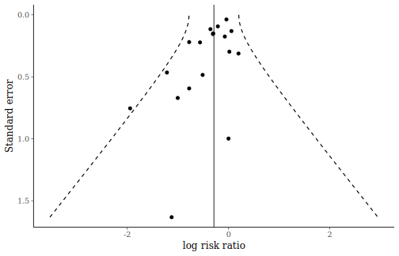

This vignette shows a short worked example of assessing and adjusting for publication
bias in a meta-analysis using _baggr_. It assumes that users are already familiar with
publication bias, funnel plots, and selection models.

# Data

We use the vitamin A supplementation and child mortality
data from @imdad_vitamin_2022, included in _baggr_ as `vitamin_a`.

For this example, the outcome is the log risk ratio for all-cause child mortality.
Negative values indicate lower mortality in the vitamin A supplementation arm.


``` r
head(vitamin_a)
#>            group      yi     sei
#> 1   Agarwal 1995  0.1972 0.31210
#> 2   Barreto 1994  0.0000 0.99840
#> 3      Benn 1997 -0.7763 0.59370
#> 4 Chowdhury 2002 -1.9419 0.75420
#> 5  Daulaire 1992 -0.3011 0.14990
#> 6     DEVTA 2013 -0.0408 0.03726
summary(exp(vitamin_a$yi))
#>    Min. 1st Qu.  Median    Mean 3rd Qu.    Max.
#>  0.1434  0.4600  0.7175  0.6885  0.9525  1.2180
```

See `?vitamin_a` for more information.

The studies are heterogeneous and vary substantially in precision.

First fit the usual Rubin summary-data model. We label the estimand as a log
risk ratio so that plots and summaries are easier to read.


``` r
bg_va <- baggr(vitamin_a, effect = "log risk ratio")
```


``` r
bg_va
#> Model type: Rubin model with aggregate data
#> Pooling of effects: partial
#>
#> Aggregate treatment effect (on log risk ratio), 18 groups:
#> Hypermean (theta) =  -0.29 with 95% interval -0.49 to -0.12
#> Hyper-SD (sigma_theta) = 0.25 with 95% interval 0.11 to 0.48
#> Posterior predictive effect = -0.30 with 95% interval -0.86 to 0.26
#> Total pooling (1 - I^2) = 0.331 with 95% interval 0.094 to 0.688
#>
#> Group-specific treatment effects:
#>                        mean median    sd  2.5%   97.5% pooling
#> Agarwal 1995         -0.101 -0.112 0.196 -0.46  0.3457   0.626
#> Barreto 1994         -0.263 -0.264 0.262 -0.79  0.2723   0.935
#> Benn 1997            -0.378 -0.346 0.250 -0.95  0.0385   0.843
#> Chowdhury 2002       -0.460 -0.420 0.289 -1.15 -0.0073   0.893
#> Daulaire 1992        -0.289 -0.288 0.120 -0.52 -0.0590   0.315
#> DEVTA 2013           -0.048 -0.049 0.037 -0.12  0.0293   0.034
#> Dibley 1996          -0.305 -0.301 0.280 -0.86  0.2161   0.974
#> Donnen 1998          -0.328 -0.323 0.233 -0.81  0.1079   0.786
#> Fisker 2014          -0.144 -0.144 0.145 -0.42  0.1517   0.377
#> Herrera 1992         -0.031 -0.038 0.121 -0.26  0.1981   0.266
#> Pant 1996            -0.425 -0.413 0.173 -0.79 -0.1186   0.479
#> Rahmathullah 1990    -0.533 -0.527 0.190 -0.94 -0.1785   0.474
#> Ross 1993 (health)   -0.495 -0.475 0.266 -1.09 -0.0453   0.774
#> Ross 1993 (survival) -0.218 -0.221 0.085 -0.38 -0.0497   0.165
#> Sommer 1986          -0.298 -0.297 0.128 -0.55 -0.0403   0.327
#> Venkatrao 1996       -0.371 -0.346 0.263 -0.94  0.0968   0.870
#> Vijayaraghavan 1990  -0.166 -0.172 0.209 -0.57  0.2741   0.605
#> West 1991            -0.342 -0.341 0.106 -0.56 -0.1533   0.224
```

# Funnel plot

A funnel plot compares study-level effects with their standard errors. In the
absence of small-study effects or unexplained heterogeneity, points should be
roughly symmetric around the pooled estimate.


``` r
funnel(bg_va)
```



The dashed lines include both sampling uncertainty and the estimated
between-study heterogeneity. If we fitted a fixed-effects model (`pooling = "full"`),
the funnel shape would have been a triangle; partial pooling gives it
more of a funnel shape.

# Selection adjustment

Selection models make the publication process explicit. For the canonical treatment,
see @hedges_modeling_1992 and @andrews_identification_2019 for framing of the same
problem in econometric literature.
In _baggr_, a selection model like in the above publications is implemented within
the Bayesian posterior calculation, using custom Stan functions.

Briefly, but more concretely:
if $y_k$ is the reported estimate and $s_k$ is its standard error, then
$z_k = y_k / s_k$, and the probability a study is observed can vary by the
interval containing $z_k$. The shorthand `selection = 1.96` fits a symmetric
two-sided model, splitting studies at the usual 5 percent normal threshold,
$|z_k| = 1.96$.

The fitted selection parameters are relative publication probabilities. With
one cut-point, _baggr_ estimates one weight for $|z_k| < 1.96$ and normalises
the reference interval, $|z_k| \ge 1.96$, to 1. For an observed study, the usual
normal likelihood is multiplied by the weight for the interval containing
$z_k$. It is then divided by the model-implied probability that a result would
be observed at all, summing over all z-intervals and their weights.

For the partial-pooling Rubin model this normalising term is calculated using
the _marginal_ distribution of the observed estimate,
$y_i \sim N(\theta + x_i^\top\beta, \sigma_\theta^2 + s_i^2)$ when covariates are present.


``` r
bg_va_sel <- baggr(vitamin_a, selection = 1.96,
                   effect = "log risk ratio")
```


``` r
bg_va_sel
#> Model type: Rubin model with aggregate data and with selection on |z|
#> Pooling of effects: partial
#>
#> Aggregate treatment effect (on log risk ratio), 18 groups:
#> Hypermean (theta) =  -0.185 with 95% interval -0.404 to -0.057
#> Hyper-SD (sigma_theta) = 0.15 with 95% interval 0.02 to 0.37
#> Posterior predictive effect = -0.19 with 95% interval -0.67 to 0.16
#> Total pooling (1 - I^2) = 0.56 with 95% interval 0.15 to 0.98
#>
#> Publication probability relative to |z| in (1.96, Inf):
#> * |z| in (0, 1.96] = 0.4 with 95% interval 0.072 to 1.3
#>
#> Group-specific treatment effects:
#>                        mean median    sd  2.5%  97.5% pooling
#> Agarwal 1995         -0.105 -0.106 0.153 -0.40  0.224    0.80
#> Barreto 1994         -0.178 -0.162 0.186 -0.59  0.161    0.97
#> Benn 1997            -0.233 -0.197 0.211 -0.76  0.100    0.93
#> Chowdhury 2002       -0.271 -0.220 0.232 -0.92  0.031    0.95
#> Daulaire 1992        -0.224 -0.210 0.121 -0.48 -0.034    0.55
#> DEVTA 2013           -0.053 -0.053 0.038 -0.12  0.026    0.14
#> Dibley 1996          -0.194 -0.173 0.193 -0.70  0.136    0.99
#> Donnen 1998          -0.216 -0.186 0.181 -0.63  0.066    0.90
#> Fisker 2014          -0.127 -0.126 0.119 -0.36  0.110    0.61
#> Herrera 1992         -0.054 -0.057 0.102 -0.25  0.164    0.50
#> Pant 1996            -0.292 -0.276 0.174 -0.67 -0.029    0.69
#> Rahmathullah 1990    -0.361 -0.346 0.200 -0.79 -0.048    0.69
#> Ross 1993 (health)   -0.304 -0.254 0.223 -0.87 -0.011    0.89
#> Ross 1993 (survival) -0.190 -0.184 0.089 -0.37 -0.032    0.37
#> Sommer 1986          -0.229 -0.223 0.123 -0.48 -0.025    0.56
#> Venkatrao 1996       -0.232 -0.190 0.206 -0.70  0.088    0.94
#> Vijayaraghavan 1990  -0.128 -0.125 0.145 -0.41  0.180    0.78
#> West 1991            -0.268 -0.265 0.111 -0.50 -0.075    0.45
selection(bg_va_sel)
#>           mean    median        sd      lower    upper width
#> [1,] 0.4017369 0.2927418 0.3401733 0.07202011 1.299228  0.95
#> attr(,"effect")
#> [1] "selection"
```

The `selection()` output reports the relative publication probability for the
lower `|z|` interval. The highest `|z|` interval is the reference category, fixed
to 1. Values below 1 mean that less statistically significant estimates are inferred
to be less likely to appear in the observed literature.

More thresholds can be used. For example, the following model separates
two-sided p-values below 10 percent, between 10 and 5 percent, between 5 and
1 percent, and beyond 1 percent.

However, please note that with only a modest number of studies, selection models can be weakly
identified. Choice of three cut-off points is done for demonstration only.


``` r
bg_va_sel_multi <- baggr(vitamin_a, selection = c(1.64, 1.96, 2.58),
                         effect = "log risk ratio")
```


``` r
selection(bg_va_sel_multi)
#>           mean   median       sd      lower     upper width
#> [1,] 3.2282171 2.032277 4.226609 0.21190139 12.122012  0.95
#> [2,] 0.6563213 0.267422 1.170622 0.01078304  4.023866  0.95
#> [3,] 6.4758467 4.666594 6.261052 0.69779743 23.465852  0.95
#> attr(,"effect")
#> [1] "selection"
```

For explicit control, users can pass a list with the z cut-points, whether the model is
symmetric, and which studies could have been selected. Here the model uses
one-sided z intervals. This is mainly useful when the direction of selection is
part of the substantive assumption:


``` r
selection_one_sided <- list(
  z = c(1.64, 1.96),
  symmetrical = FALSE,
  possible = rep(1, nrow(vitamin_a))
)

bg_va_sel_one_sided <- baggr(vitamin_a, selection = selection_one_sided,
                             effect = "log risk ratio")
```


``` r
selection(bg_va_sel_one_sided)
#>           mean    median       sd      lower    upper width
#> [1,] 15.915402 4.8501906 37.63726 0.33531826 90.54151  0.95
#> [2,]  2.395249 0.6730006  6.57713 0.01306289 13.50824  0.95
#> attr(,"effect")
#> [1] "selection"
```


# References
